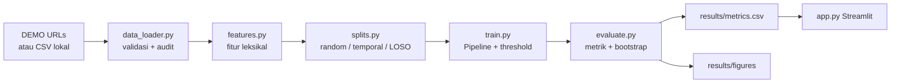

# Phishing URL Generalization

**Evaluasi Generalisasi Deteksi URL Phishing melalui Random, Temporal, dan Cross-Source Split**

Repositori ini berisi pipeline penelitian untuk menguji seberapa baik model
leksikal mendeteksi URL phishing ketika distribusi data berubah. Tiga rezim
evaluasi dibandingkan:

1. **Random split** — baseline optimistis; domain yang sama dapat muncul di
   train dan test.
2. **Temporal split** — test selalu berasal dari periode paling baru.
3. **Cross-source (leave-one-source-out)** — model dilatih pada sebagian feed
   dan diuji pada feed yang sama sekali belum dilihat.

> **Status hasil:** kode, data DEMO sintetis, dan unit test tersedia. Eksperimen
> model **belum dijalankan** pada sesi ini, sehingga README tidak memuat angka
> performa. Jalankan `scripts/run_experiments.py` untuk menghasilkan metrik
> aktual. Semua angka dari mode DEMO adalah hasil sintetis, bukan temuan nyata.

---

## Research questions

1. Berapa besar penurunan PR-AUC dari random ke temporal split?
2. Berapa besar penurunan ketika model diuji pada sumber yang tidak pernah
   dilihat saat training?
3. Apakah domain test sudah muncul di training, dan bagaimana hubungannya
   dengan performa?
4. Apakah `class_weight` meningkatkan recall kelas phishing tanpa merusak
   precision secara berlebihan?
5. Apakah kalibrasi probabilitas tetap masuk akal pada data yang bergeser?

## Fitur

Ekstraksi **leksikal saja**, tanpa DNS/WHOIS/pengambilan halaman. Ini menjaga
reproducibility dan menghindari fitur yang tidak tersedia saat deployment.

| Kelompok | Contoh |
|---|---|
| Panjang | panjang URL, host, path, query |
| Karakter | digit, simbol, titik, hyphen, `@`, `%`, `//` di path |
| Struktur | jumlah subdomain, kedalaman path, port, IP host, punycode, HTTPS |
| Leksikal | token mencurigakan (`login`, `verify`, `account`, …), entropi host/path |
| Domain | TLD, shortener, domain perkiraan (dua label terakhir) |

Fitur yang **tidak** digunakan: label, isi halaman, usia domain, reputasi,
sertifikat TLS, atau hasil feed lain. Ini menghindari leakage langsung, tetapi
membatasi kekuatan model. Domain perkiraan memakai heuristik dua label terakhir,
bukan Public Suffix List — keterbatasan yang disengaja dan didokumentasikan.

## Desain split

| Split | Train | Validation | Test | Tujuan |
|---|---|---|---|---|
| `random` | 70% stratified | 10% | 20% | Baseline |
| `temporal` | 70% terlama | 10% berikutnya | 20% terbaru | Generalisasi waktu |
| `cross_source` | sumber lain | 15% dari sumber lain | 1 sumber penuh | Generalisasi sumber |

Threshold dipilih dengan memaksimalkan F1 pada **validation**; test tidak
digunakan untuk memilih threshold atau model. Model "terbaik" dilaporkan
berdasarkan PR-AUC validation.

### Diagnostik kebocoran domain

`domain_overlap(train, test)` menghitung fraksi URL test yang domain
perkiraannya muncul di train. Nilai tinggi pada random split menunjukkan model
bisa mengandalkan domain yang sama, bukan pola phishing yang dapat
digeneralisasi.

## Model dan metrik

- Logistic Regression (`lbfgs`, maksimum 2000 iterasi)
- Random Forest (300 pohon, `min_samples_leaf=3`)
- Strategi: tanpa bobot dan `class_weight`
- Preprocessing (imputasi, scaling, one-hot) berada di dalam `Pipeline` dan
  hanya di-fit pada training.

Metrik: PR-AUC (average precision), ROC-AUC, precision, recall, F1, balanced
accuracy, Brier score, false positive/negative rate, dan confusion matrix.
PR-AUC menjadi metrik utama karena kelas phishing minoritas.

Interval kepercayaan 95% untuk PR-AUC dihitung dengan **percentile bootstrap**
pada test set model terbaik (default 200 resample). Ini menggambarkan
ketidakpastian sampling, bukan variasi antar sumber.

## Arsitektur



## Struktur repositori

```
phishing-url-generalization/
├── app.py
├── data/
│   ├── README.md          # sumber, skema, etika
│   ├── demo/              # CSV DEMO (gitignored)
│   └── raw/               # data nyata (gitignored)
├── results/
├── scripts/
│   ├── make_demo_data.py
│   ├── download_phishing_data.py   # verifikasi CSV lokal
│   └── run_experiments.py
├── src/
│   ├── config.py
│   ├── demo_data.py
│   ├── data_loader.py
│   ├── features.py
│   ├── splits.py
│   ├── train.py
│   ├── evaluate.py
│   └── visualization.py
├── tests/
├── requirements.txt
└── README.md
```

## Instalasi

Python 3.10+ (diuji pada Python 3.11.9).

```bash
python -m venv .venv
# Windows PowerShell
.venv\Scripts\Activate.ps1
# Linux/macOS
source .venv/bin/activate
pip install -r requirements.txt
```

## Menjalankan

### 1. DEMO

```bash
python scripts/make_demo_data.py --n-urls 6000
python scripts/run_experiments.py --source demo
streamlit run app.py
```

Semua output DEMO diberi label sintetis. Jangan mengutipnya sebagai bukti
kemampuan deteksi.

### 2. Data nyata

Siapkan `data/raw/phishing_urls.csv` sesuai skema di
[`data/README.md`](data/README.md), lalu:

```bash
python scripts/download_phishing_data.py --path data/raw/phishing_urls.csv
python scripts/run_experiments.py --source csv --raw-dir data/raw/phishing_urls.csv
streamlit run app.py
```

### 3. Eksperimen lebih cepat

```bash
# Hanya satu model, tanpa cross-source
python scripts/run_experiments.py --source demo --models logistic_regression --skip-cross-source
```

## Output

| File | Isi |
|---|---|
| `results/metrics.csv` | Semua konfigurasi split × model × strategi |
| `results/summary.json` | Ringkasan dari hasil aktual |
| `results/best_model.json` | Model terbaik + interval bootstrap |
| `results/dataset_audit.json` | Jumlah URL, duplikasi, komposisi sumber, tanggal |
| `results/split_summary_*.json` | Ukuran, proporsi kelas, domain overlap |
| `results/predictions/best_model_test_predictions.csv` | Prediksi test |
| `results/figures/*.png` | Class balance, timeline, heatmap cross-source, PR curve, calibration, domain overlap |

## Pengujian

```bash
pytest
```

Status pada mesin pengembangan: **35 passed**.

Cakupan:

- ekstraksi fitur URL valid, IP, port, query, path, dan domain,
- penolakan URL malformed/non-HTTP,
- determinisme dan domain reserved pada data DEMO,
- split random/temporal/cross-source, disjointness, dan deteksi overlap,
- pipeline Logistic Regression, pemilihan threshold hanya dari validation,
- metrik, per-source breakdown, bootstrap, dan ringkasan hasil,
- audit dataset dan round-trip CSV.

Test tidak menjalankan eksperimen penuh dan tidak mengunduh data.

## Keterbatasan

- **DEMO sepenuhnya sintetis**; label berasal dari aturan leksikal + noise.
- Tidak ada analisis konten halaman, DNS, TLS, atau reputasi domain.
- Domain perkiraan hanya dua label terakhir; eTLD+1 memerlukan Public Suffix
  List.
- Cross-source mencampur perbedaan domain, kebijakan label, dan periode
  koleksi; hasilnya tidak memisahkan penyebab.
- Phishing bersifat adversarial: penyerang dapat menghindari fitur leksikal.
- Satu dataset/sumber belum tentu mewakili populasi global.
- Model ini bukan blocklist, bukan pengganti sandbox, dan tidak boleh
  mengambil keputusan keamanan otonom.

## Etika

Jangan membuka URL mencurigakan, jangan memasukkan kredensial, dan jangan
meng-commit data feed yang dilindungi lisensi. Lihat
[`data/README.md`](data/README.md).

## Lisensi

Kode: MIT (lihat `LICENSE`). Data pihak ketiga tetap mengikuti lisensinya.
